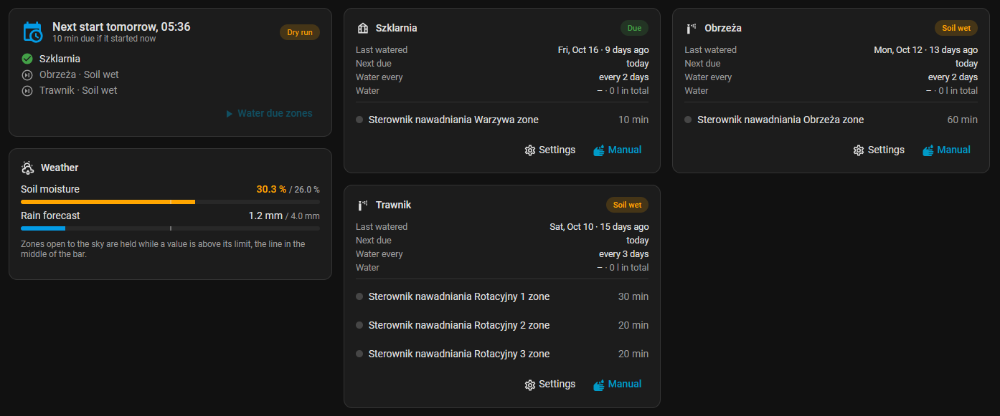
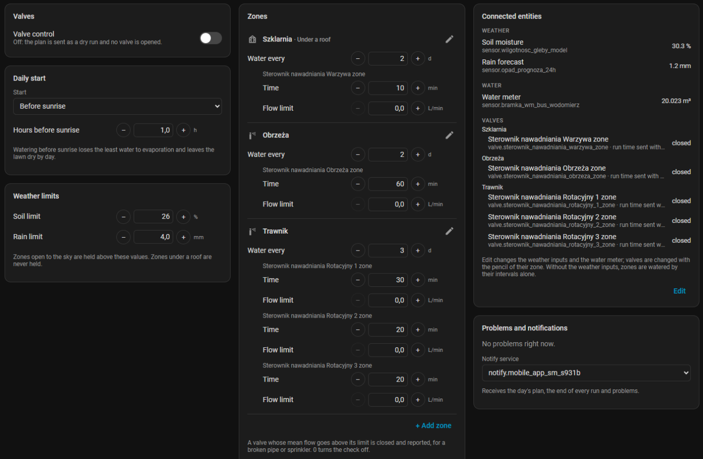
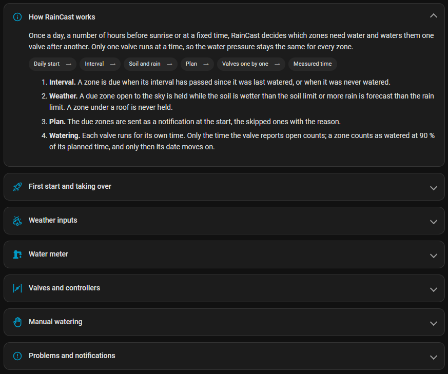

<p align="center">
  
</p>

<p align="center">
  Weather-aware irrigation for Home Assistant: zones with their own intervals, soil and rain holds, metered valves.
</p>

<p align="center">
  <a href="https://github.com/Holczyns/raincast/actions/workflows/validate.yml"></a>
  <a href="https://github.com/Holczyns/raincast/actions/workflows/tests.yml"></a>
  <a href="https://hacs.xyz"></a>
</p>

RainCast waters a garden from Home Assistant. Each zone has its own daily start, before sunrise or at a fixed time,
its own interval, valves and soil limit. Zones are held when their soil is wet, when rain is coming for zones open to
the sky, and in frost. The valves run one after another, and only the time a valve actually reports open counts as
watering.

It drives any `valve`, `switch` or `input_boolean` entity, so it works with irrigation controllers such as Orbit
B-hyve, relays on ESPHome or Shelly devices, and smart plugs alike.



## Features

- **Setup wizard** for the weather inputs, the water meter and the zones.
- **Sidebar panel** with the day's plan, the weather against its limits, a card per zone, a run log, water and valve
  history, all settings and a built-in guide.
- **Zones** with any number of valves, their own start, an interval in days, a time per valve and an *under a roof*
  flag for greenhouses and covered beds. Zones starting together run as one; a start during a run waits for it.
- **Soil per zone**: each zone can have its own soil sensor or input number and has its own soil limit; a zone without
  one does not look at the soil.
- **Rain and frost holds**: a rain forecast sensor for zones open to the sky and an outdoor temperature sensor that
  stops all watering below the frost limit. All inputs are optional.
- **Season and main switch**: automatic watering only between two months, for example April to September, and a main
  switch for all daily starts. Manual runs work regardless.
- **Mower** (optional): any `lawn_mower` entity goes out at its own start, from sunrise, sunset or a fixed time, in its
  own season. It stays in when a zone that blocks mowing was watered today, while it rains, for some hours after rain,
  when rain is due, and in frost; *Mow now* sends it out regardless. Rain now, the last rain and the next rain come from
  a weather entity with an hourly forecast.
- **Dry run** by default. RainCast sends the day's plan as a notification but opens no valve until valve control is
  switched on, so it can be compared with the current setup first.
- **Measured watering**: a zone counts as watered only when its valves reported open for at least 90 % of the
  planned time. Controllers that end a manual run on their own preset are started again with the time left.
- **Water meter** (optional): litres and flow per valve run, a *Water used* sensor per zone for the energy dashboard,
  a check for valves open without water, and a flow limit per valve that closes the valve on a broken pipe.
- **Manual runs**: water the due zones now, or one zone with your own minutes per valve.
- **Problem reporting** on the Repairs page, on a problem sensor and optionally through any notify service: an
  unavailable valve, a valve that does not open or does not close, no water, too much flow, lost weather data.
- **Restart safe**: the valves of a run cut off by a Home Assistant restart are closed on the next start.





## Requirements

- Home Assistant 2026.10 or newer.
- Valves as `valve`, `switch` or `input_boolean` entities.
- Optional: a soil moisture sensor in % per zone, a rain forecast sensor in mm for the coming day, an outdoor temperature
  sensor, a weather entity with an hourly forecast, a total water meter in m³ or L, a lawn mower, a notify service.

Any sensor works for the weather inputs. Open-Meteo provides both as a model value without hardware, for example
through a [RESTful sensor](https://www.home-assistant.io/integrations/rest/) reading `soil_moisture_3_to_9cm` and
the hourly `precipitation` of the coming 24 hours.

## Installation

### HACS

1. In HACS, open the menu in the top right corner and choose **Custom repositories**.
2. Add `https://github.com/Holczyns/raincast` with the type **Integration**.
3. Search for **RainCast**, download it and restart Home Assistant.
4. Go to **Settings → Devices & services → Add integration** and choose **RainCast**.

### Manual

Copy `custom_components/raincast` into the `custom_components` folder of your Home Assistant configuration and
restart Home Assistant.

## Setup

The wizard asks for:

1. **A name** for the controller.
2. **Weather, water and mower**: rain forecast, outdoor temperature, weather entity, water meter and lawn mower. All
   optional; everything can be changed later in the panel.
3. **Zones**: a name, the valves in the order they run, *under a roof*, *blocks mowing*, a soil sensor, the interval
   and a starting time per valve. Add as many as you need.

Afterwards open **RainCast** in the sidebar. In **Settings** you set the season, the rain and frost limits, and for
each zone its start, soil limit, interval and the time and flow limit of each valve; you also add, edit or remove
zones and choose the notify service.

## Taking over the watering safely

1. Leave **Valve control** off for a few days and compare the plan RainCast sends with your current setup.
2. Turn off every other schedule watering the same valves, including the controller's own programs and smart
   watering. Two writers on one valve end in runs nobody planned.
3. Turn on **Valve control** in the panel settings and watch the first run on the Home tab.

Turning valve control off ends a run in progress and closes its valve. **Stop** always closes every valve of the
controller.

## How it works

```
zone start ─► automatic on, in season? ─► interval due? ─► frost? ─► soil above zone limit? ─► rain (open zones)? ─► plan
plan ─► valve 1 ─► valve 2 ─► … ─► measured time ≥ 90 % ─► zone watered, date moves on
            └─ water meter: litres, no water, flow limit
```

- **Start**: each zone starts at its own time. Zones starting within a minute of each other run as one, with one
  notification; a start during a run waits for it to end.
- **Interval**: a zone is due when its interval in days has passed since the last watering, or when it was never
  watered.
- **Frost**: below the frost limit no zone is watered by a start or by *Water due zones*.
- **Soil**: a due zone with a soil sensor is held while its soil moisture is above its limit; a zone without one
  does not look at the soil.
- **Rain**: a due zone open to the sky is held while the rain forecast is above the rain limit.
- **Missing values**: an input that is not set or has no value holds nothing, so a dead weather service never stops
  the garden from being watered; it is reported after an hour.
- **Valves**: a valve that does not report open within a minute is skipped and reported. Valves of the
  [B-hyve integration](https://github.com/sebr/bhyve-home-assistant) get their run time with the start command, so
  they close by themselves even if Home Assistant stops in the middle of a run.
- **Water meter**: each valve is metered from its start to the start of the next one; the last valve a minute after
  it closed, because meters report with a delay. A meter without a reading for ten minutes is not used for the
  checks. A meter shared with the house also counts water used there during a run.

The plan, the schedule, the valve supervision and the flow checks live in `custom_components/raincast/engine`
without Home Assistant imports and are tested on their own.

## Entities

Controller device:

| Entity | Purpose |
|---|---|
| Valve control (switch) | Off: dry run, no valve is opened |
| Automatic watering (switch) | Main switch of the daily starts |
| Season starts, Season ends (select) | Months of automatic watering |
| Rain limit, Frost limit (number) | Weather holds; the frost limit with an outdoor sensor |
| Next start, Planned time (sensor) | The coming start and the minutes due now |
| Watering, Problem (binary sensor) | Run in progress; faults with the list as an attribute |
| Water due zones, Stop watering (button) | Manual run and stop |
| Raining (binary sensor), Hours since rain, Hours to rain (sensor) | Rain from the weather entity |
| Automatic mowing (switch), Mower start (select), Mower start time (time), Mower start offset (number) | The mower's start |
| Mowing season starts, Mowing season ends (select), Dry hours after rain, Rain ahead hours (number) | Mower season and rain holds |
| Mowing, Next mowing (sensor), Mow now (button) | What keeps the mower in, its next start, a forced start |

Each zone device:

| Entity | Purpose |
|---|---|
| Status, Next due, Next start (sensor) | Due, waiting, held by frost, soil or rain, watering |
| Start (select), Start time (time), Start before sunrise (number) | The zone's daily start |
| Last watered (date) | Editable, to correct or carry over a date |
| Soil limit, Interval, Time per valve, Flow limit per valve (number) | Zone settings |
| Water used (sensor) | Litres over all runs, with a water meter |
| Water now (button) | Waters the zone with its own times |

## Development

```bash
# engine tests, any Python 3.13+
python -m pytest tests/engine

# integration tests, Python 3.14 with pytest-homeassistant-custom-component (Linux or macOS)
python -m pytest tests

# panel
cd frontend && npm ci && npm run check && npm run build
```

The built panel in `custom_components/raincast/www` is committed, so installing through HACS needs no build step.

## License

[MIT](LICENSE)
